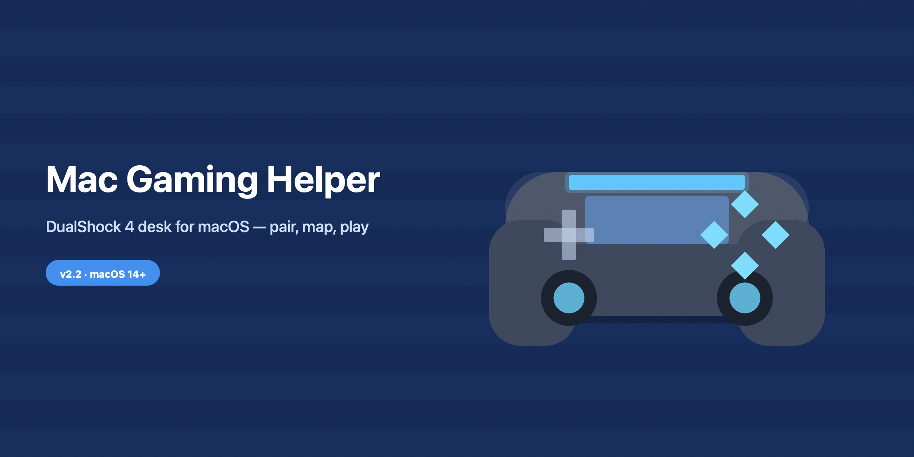
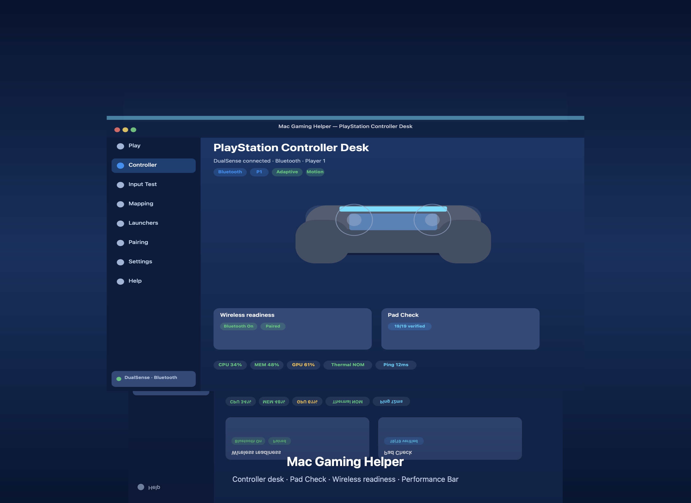
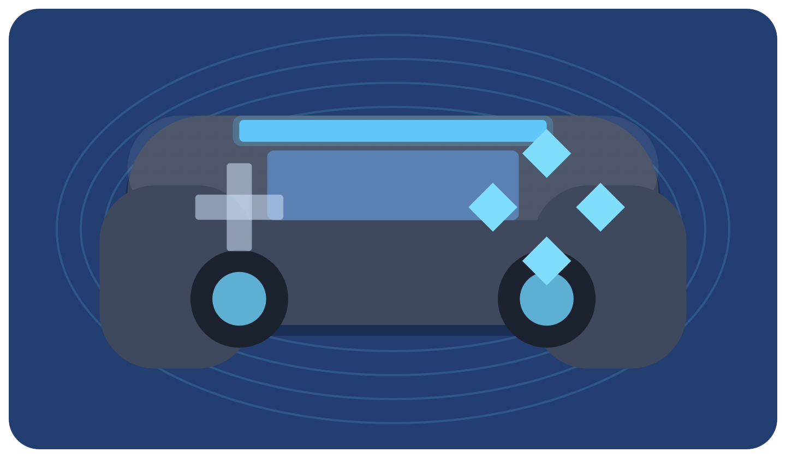
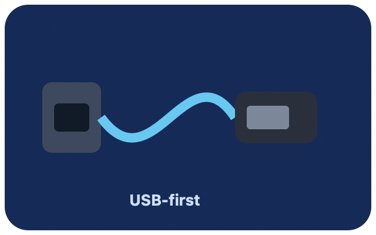
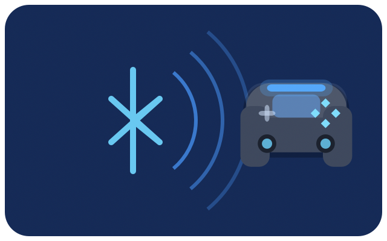

<p align="center"></p>

<!-- zerodevllc-theme -->
[](https://ZeroDevLLC.com)
[](https://ZeroDevLLC.com)

```
  ______             ____              _     _     ____
 |__  /___ _ __ ___ |  _ \  _____   __| |   | |   / ___|
   / // _ \ '__/ _ \| | | |/ _ \ \ / /| |   | |  | |
  / /|  __/ | | (_) | |_| |  __/\ V / | |___| |__| |___
 /____\___|_|  \___/|____/ \___| \_/  |_____|_____\____|
                    ZeroDev LLC
                      Mac Gaming Helper
    https://ZeroDevLLC.com  ·  https://zerodevllc.store
```

# Mac Gaming Helper

**[Mac Gaming Helper](https://ZeroDevLLC.com)** by [ZeroDev LLC](https://ZeroDevLLC.com) · GitHub: [ZeroXSHDW/MacGamingHelper](https://github.com/ZeroXSHDW/MacGamingHelper)

> Brand: **[https://ZeroDevLLC.com](https://ZeroDevLLC.com)** · Store: **[https://zerodevllc.store](https://zerodevllc.store)**  
> Production releases → public-bound `MacGamingHelper`.  
> Active development → private twin [`MacGamingHelper-dev`](https://github.com/ZeroXSHDW/MacGamingHelper-dev).


## Standalone — no assistant required

This repo and the app on this Mac are complete. You do **not** need any chat bot to run, rebuild, or update Mac Gaming Helper.

| What you need | Where |
|---|---|
| Run the app | `/Applications/Mac Gaming Helper.app` or Desktop **Start Mac Gaming Helper.command** |
| Source | This repository: https://github.com/ZeroXSHDW/MacGamingHelper |
| Latest download | https://github.com/ZeroXSHDW/MacGamingHelper/releases/latest |
| Rebuild | `./scripts/install.sh` |
| Install / repair Heroic | `./scripts/install-heroic.sh` |
| Install launchers | `./scripts/install-gaming-launchers.sh [--steam] [--geforce]` |
| Health check | `./scripts/doctor.sh` |
| Permissions panes | `./scripts/open-permissions.sh` |
| Gatekeeper unblock | `./scripts/fix-gatekeeper.sh` |

---


## Easiest run

1. Open **`/Applications/Mac Gaming Helper.app`** (or Desktop → **Start Mac Gaming Helper.command**)
2. Tap **Start gaming** on the Play page (or menu bar → Start gaming)
3. The **Performance Bar** appears at the top — you’re ready

If macOS says it can’t be opened: Right-click → Open, or run `scripts/fix-gatekeeper.sh`.


Native SwiftUI macOS app for playing with a **PlayStation DualSense (PS5) or DualShock 4 (PS4)** on Apple silicon Macs (macOS 14+).



Live controller desk (Game Controller / `GCController`), schematic PlayStation layout, correct USB vs Bluetooth transport, light bar, haptics, DualSense adaptive-trigger demo, optional keyboard/mouse mapping, and a **Pairing / Setup** coach with illustrated USB-first rescue steps for the common “light flashes but Bluetooth never lists the pad” failure.





## Relation to Game Bay

This project **continues and improves** the earlier Game Bay prototype (local checkout when present; not required).

- Game Bay is **not deleted**. Keep using it for Coach / library features if you like.
- Mac Gaming Helper keeps the launcher hub (Steam, Heroic, GeForce NOW) and replaces the thin controller page with a PlayStation-first desk: multi-pad selection, live diagram, stylized pad art, light bar, haptics, adaptive-trigger demo, pairing coach, and optional keyboard/mouse mapping.

## Install to Applications & permissions

```bash
./scripts/install.sh          # prefers /Applications, falls back to ~/Applications
./scripts/open-permissions.sh # opens Privacy panes (you must flip toggles ON)
```

### Launchers (Heroic, Steam, GeForce NOW)

```bash
./scripts/install-heroic.sh                    # installs or repairs Heroic (Homebrew cask, DMG fallback)
./scripts/install-gaming-launchers.sh          # Heroic only
./scripts/install-gaming-launchers.sh --all    # Heroic + Steam + GeForce NOW
```

`install-heroic.sh` validates the download is a real `.app` bundle before installing.
If an earlier attempt left an HTML error page named `Heroic-Games-Launcher.app` in
`/Applications`, the script moves it to the Trash and installs the genuine app.
The Launchers page marks such broken artifacts as **Needs reinstall** and can open
the official download page for you.

Steam’s macOS client is Intel-only, so it needs **Rosetta 2** on Apple silicon.
`install-gaming-launchers.sh --steam` installs Rosetta first when necessary. Use
`./scripts/doctor.sh` at any time to check the app, launchers, Rosetta, signatures,
libraries and shortcuts.

**Enable for Mac Gaming Helper:**
1. **Privacy & Security → Bluetooth** — pad discovery  
2. **Privacy & Security → Accessibility** — only if using Mapping  
3. **Notifications** — low-battery alerts  
4. **Local Network** — optional (Ping metric)  
5. **Automation** — if macOS prompts for Steam / System Settings  

**Show the Performance Bar:** Settings → Overlay & performance, or menu bar → Show Performance Bar, or **⌃⌥⌘P**. Or tap **Apply recommended gaming setup** in Settings → Permissions.

## Gaming Overlay (3.3)

- Always-on-top **Performance Bar** or Compact HUD while gaming
- Live CPU / Memory / GPU (when IOKit allows) / Ping / Panel Hz / pad battery / mapping / **Thermal** / **hottest core**, plus **CPU & GPU history sparklines**
- Does **not** fake game FPS — shows display refresh as Panel Hz
- Toggle: Settings, menu bar, or ⌃⌥⌘P

## Gaming (3.2)

- **Input Test** tab to verify every PlayStation control before a match
- Keep display awake during Play HUD / gaming session
- Steam favourites + filter; Heroic library when present
- Connect/disconnect audio cues; combo macro (hold L1 + tap face button)

## Gaming (3.1)

- Open the **Play** tab for Session Prep and Steam quick-launch.
- **Prep Steam session** turns Mapping off and opens Big Picture (Steam Input owns the DualSense / DualShock 4).
- Optional **Play HUD** stays on top while in a game (Settings or menu bar).
- Mapping aim: response curves + aim sensitivity; hair-trigger L2/R2; ⌥⌘M pause; ⌘⌥1–3 profiles.

## Features

- Apple **Game Controller** — DualSense (`GCDualSenseGamepad`), DualShock 4 (`GCDualShockGamepad`), and other extended pads
- **Background input monitoring** so Mapping and the overlay keep working while a game is frontmost
- Connect / disconnect notifications + **Rediscover** wireless scan
- Live button / stick / trigger readouts and a schematic PlayStation layout (✕ ○ □ △)
- Battery, **correct USB vs Bluetooth transport**, Player 1–4 slot, light-bar tint, haptic pulse, and DualSense **adaptive-trigger demos** (weapon, slope, vibration)
- **Pairing / Setup** coach with a DualSense / DualShock 4 selector: Create + PS or Share + PS, USB-C / Micro-USB rescue, reset pinhole, Steam Big Picture vs Mapping, permissions
- Optional **keyboard / mouse mapping** profiles (FPS WASD, Arrows) for non-gamepad titles; Create and Share both map correctly
- **Multi-slot combo macros** — hold + tap → key, with as many slots as you need
- **Pad Check wizard** — press each control once and it checks off automatically, with a copyable pass/incomplete report
- **Wireless readiness** — Bluetooth power, paired/connected DualSense or DualShock 4, and whether it is safe to unplug USB
- **Game profiles** — per-app mapping, overlay mode/visibility, keep-awake and Steam-Input pause, applied automatically when that app is frontmost
- **Profile import / export** — save and share mapping profiles as JSON
- **Heroic deep-launch** — launch Epic / GOG / Amazon games directly from the Play page
- **Power & performance** — detect Low/High Power Mode and thermal pressure, with guidance to keep the Mac running at full speed
- **Global hotkeys** — ⌥⌘M (Mapping pause), ⌃⌥⌘P (Overlay) and ⌘⌥1–3 (profile switch) work system-wide, even while a game is frontmost
- **Haptic & trigger intensity** — one slider controls rumble strength and DualSense adaptive-trigger resistance
- **Session time** metric on the Performance Bar (mm:ss)
- **v3.15:** per-core CPU (hottest core), About/polish
- **v3.14:** CPU/GPU sparklines, multi-slot macros, live panel Hz
- **v3.13:** per-game settings profiles (mapping + overlay + keep-awake)
- **v3.12:** haptic/trigger intensity slider, README 3D render
- **v3.11:** global profile-switch hotkeys, session timer on the Performance Bar, PlayStation copy cleanup
- **v3.10:** global in-game hotkeys
- **v3.9:** power & thermal detection, Thermal metric on the Performance Bar
- **v3.8:** profile import/export, Heroic deep-launch, Bluetooth battery fix, adaptive-trigger demos
- **v3.7:** per-app mapping profiles with auto-switch
- **v3.6:** guided Pad Check, wireless readiness, controller capability dump in diagnostics
- **v3.5:** DualSense adaptive triggers, IOKit USB/Bluetooth detection, background input, multi-pad player slots, event-driven button snapshots, 60 Hz mapping loop, App Nap protection, `--controller-test`
- **v3:** sidebar sections, LIVE mapping pause (⌥⌘M), diagnostics export, motion honesty, Steam Big Picture safety
- **Menu bar** status, Settings (login item, deadzones, updates), custom mapping profiles, low-battery alerts
- Offline self-test: `MacGamingHelper --self-test`
- Offline controller diagnostic: `MacGamingHelper --controller-test`
- Offline — no accounts required for controller status or mapping

### Pairing illustrations

| USB-first | Bluetooth |
|---|---|
|  |  |

## Requirements

- macOS 14 or later (Apple silicon recommended)
- Xcode Command Line Tools (`xcode-select --install`) so `swiftc` and a macOS SDK are available
- Rosetta 2 for Steam only (Apple silicon): `softwareupdate --install-rosetta --agree-to-license`

## Clone / build / install

```bash
git clone https://github.com/ZeroXSHDW/MacGamingHelper.git
cd MacGamingHelper
./scripts/install.sh
```

Installs to `/Applications/Mac Gaming Helper.app` (fallback `~/Applications`) and adds a Desktop symlink. Game Bay is left untouched.

Build only (into `dist/`):

```bash
./scripts/build.sh
```

`build.sh` regenerates stylized PNGs into `Resources/`, copies them into the `.app` bundle, builds the icon, and compiles Sources.

Self-test after install:

```bash
./scripts/self-test.sh
# or:
"/Applications/Mac Gaming Helper.app/Contents/MacOS/MacGamingHelper" --self-test
```

Controller diagnostic (kind, USB/Bluetooth, battery, player slot, light/haptics/adaptive/motion):

```bash
"/Applications/Mac Gaming Helper.app/Contents/MacOS/MacGamingHelper" --controller-test
# verify Cross, Circle, L2 and the left stick on a newly paired pad:
"/Applications/Mac Gaming Helper.app/Contents/MacOS/MacGamingHelper" --controller-test --watch
./scripts/doctor.sh
```

## Pair a PlayStation controller

### DualSense (PS5)

1. **USB-C**: use a data cable (not charge-only), plug in, press **PS**, then Rediscover.
2. **Bluetooth**: hold **Create + PS** until the light bar flashes quickly.
3. System Settings → Bluetooth → **DualSense Wireless Controller** → Connect.
4. Open Mac Gaming Helper → **Rediscover** → the Controller page should show live sticks and buttons.

### DualShock 4 (PS4)

1. **Micro-USB**: use a data cable, plug in, press **PS**, then Rediscover.
2. **Bluetooth**: hold **Share + PS** until the light bar flashes quickly.
3. System Settings → Bluetooth → **Wireless Controller** → Connect.
4. Open Mac Gaming Helper → **Rediscover**.

### USB-first (when the light flashes but the pad never appears)

1. Use a **data** cable (USB-C for DualSense, Micro-USB for DualShock 4).
2. Plug into the Mac, press **PS** once, then Rediscover.
3. Optionally complete Bluetooth pairing while still on USB, then unplug.
4. Quit Steam while pairing if the pad is not appearing — Steam can hold the controller.

### Reset

Flip the pad over → paperclip in the **reset pinhole** near L2 for ~5 seconds → retry USB or the wireless pairing chord.

Full steps live in the app under **Pairing / Setup**, with a DualSense / DualShock 4 selector.

### Steam vs Mapping

- Steam: use **Big Picture** so Steam Input owns the pad. Keep Mapping **off**.
- Mapping: for apps that ignore gamepads. Requires **Accessibility**.

## Permissions

| Permission | When |
|---|---|
| **Bluetooth** | Pair DualSense / DualShock 4 wirelessly |
| **Accessibility** | Only when Mapping is enabled (posts CGEvents). Deny safely leaves Mapping off. |
| **Input Monitoring** | Only if macOS prompts; not required for basic GCController readouts |

## Project layout

```
Resources/          # Bundled PNG art (generated by scripts/make-assets.swift)
Sources/            # SwiftUI app
scripts/build.sh    # Compile + package .app
scripts/make-3d-render.swift  # 3D README mockup (docs/screenshots/app-3d.png)
scripts/install.sh  # Install to /Applications (fallback ~/Applications)
docs/screenshots/   # README images (banner, 3D render, pairing)
```

## Known limits

- **Gatekeeper / ad-hoc signature**: builds are ad-hoc signed (`codesign -s -`). First open may need Right-click → Open, or `xattr -cr` on the `.app` (install.sh already clears quarantine when possible).
- **Accessibility**: Mapping cannot post keys until you enable the app in Privacy & Security → Accessibility.
- **Bluetooth quirks**: some DualSense / DualShock 4 units never show in macOS Bluetooth until USB pairing succeeds once.
- **Light bar / haptics / adaptive triggers**: depend on what Game Controller exposes for that firmware and connection mode. Adaptive triggers require a DualSense.
- **USB vs Bluetooth label**: read through IOKit HID. If that probe is blocked, the app falls back to Game Controller’s transport guess.
- **Artwork**: stylized / abstract silhouettes — not photo-realistic trademark replicas.
- **Sandbox**: entitlements disable App Sandbox so Bluetooth + CGEvent mapping work; this is intentional for a local helper.

## Changelog

See [CHANGELOG.md](CHANGELOG.md) for 3.0.0 release notes.

## License

MIT — see [LICENSE](LICENSE).

---

<p align="center"><sub><code>ZeroDevLLC · cyber-deck · local-first · no cloud · no telemetry</code></sub></p>
